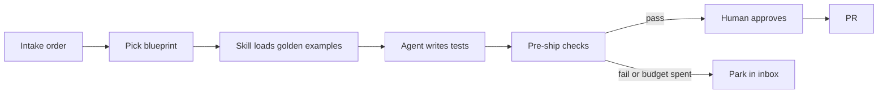

# Test-Automation Factory — Blueprint and Prompt Pack

A standalone "software factory" for **test automation only**. You copy this folder into a new or existing
project, then run the phase prompts in order. Each phase is one pull request. The pack needs no particular
tool: any coding agent (Claude Code, Cursor, Copilot agent mode) can run the prompts, and a human can follow
them by hand.

## What the factory is

A factory takes **work orders** (intake files), builds **tests** from them under fixed **patterns**, and checks
the result against **budgets**, **rules**, and **golden examples**.

*Diagram: an order selects a blueprint, a skill loads the matching golden examples, and the agent writes tests.
Checks gate the result. A failure or an exhausted budget parks the order for a human.*

## What the factory is not

- It is not an application builder. It writes tests, test harness code, and test tooling only.
- It is not tied to one framework. The **pattern** is fixed (see below). The **tooling** is your choice.
- It does not deploy anything and does not post to external systems without human approval.

## Fixed pattern, soft tooling

| Test type | Fixed pattern | Soft choice |
|---|---|---|
| UI end-to-end | Saturday-like: Site, Page, Element, Partial, Flow. No classic page objects. | Playwright, Cypress, Selenium |
| API | Sunday-like: declarative API client, HTTP adapter interface, fluent matchers, schema validation | Playwright request, Supertest, RestAssured, httpx |
| Unit | Arrange, Act, Assert. Doubles at interface boundaries. | Vitest, Jest, pytest, JUnit, xUnit, Go `testing` |
| Your own type | Whatever your custom blueprint states | Whatever your custom blueprint states |

All code follows clean code, clean architecture, and the design-pattern table in `phases/phase-1-rules-and-guardrails.md`.

## How to adopt it

1. Copy this folder to `docs/test-factory/` in your project (or keep it as its own template repository).
2. Open `BLUEPRINT.md`. It describes the target end state.
3. Commit the copied pack on its own, so each phase's diff stays clean. Then run `phases/phase-0-adopt-and-baseline.md`. It detects whether your project is new or existing.
4. Run phases 1 to 9 in order. Merge each pull request before starting the next.
5. Add your own blueprints with the `new-blueprint` skill (phase 3 and phase 5).

For a one-shot run, `full-prompt.md` holds every phase in one file. One phase per pull request is the
recommended path, because each phase has its own verification step.

## Phase map

| Phase | Prompt | Result |
|---|---|---|
| 0 | `phase-0-adopt-and-baseline.md` | Project facts, ADR-000, domain dictionary, baseline numbers |
| 1 | `phase-1-rules-and-guardrails.md` | Clean code, architecture, design-pattern, repair, and approval rules |
| 2 | `phase-2-intake.md` | Intake template, README, validator |
| 3 | `phase-3-blueprint-registry.md` | Built-in blueprints, custom blueprint folder, registry, validator |
| 4 | `phase-4-pattern-docs.md` | Framework status, work orders for any missing framework pieces, Saturday-like and Sunday-like pattern documents |
| 5 | `phase-5-skills.md` | Testing skills: `api-test`, `ui-e2e-test`, `unit-test`, `test-audit`, `new-blueprint`, `exemplar-audit`, and a skill validator |
| 6 | `phase-6-golden-examples.md` | Exemplar manifest (with can-fail evidence), annotations, consistency check |
| 7 | `phase-7-budgets-and-time-boxes.md` | Budget and time-box policy, enforcement script |
| 8 | `phase-8-runner.md` | Optional supervisor loop, with a manual mode by default |
| 9 | `phase-9-preship-and-reporting.md` | Ten timed pre-ship checks, complexity gate, reporting, CI proposal |

## Every phase has the same headers

`Goal`, `Inputs`, `Steps`, `Files`, `Verification`, `Budget`, `Time-box`. A phase is done only when its
`Verification` section passes. If a phase runs out of budget or time, stop, write a checkpoint note, and
ask a human. Do not widen the ceiling yourself.

## Glossary

- **Order**: one intake file describing one piece of test work.
- **Blueprint**: a document that fixes the pattern, layers, and scaffold for one test type.
- **Skill**: a short prompt file that tells an agent how to do one job, such as write an API test.
- **Exemplar**: a real, running test marked as the one to copy. Also called a golden example.
- **Park**: stop an order, record why, and leave it for a human. Parking is not failing.
- **Time-box**: a hard limit on elapsed time for an order or a stage.

---
*Derived from the [ai-assistant-dot-files](https://github.com/orieken/loom) Context Engineering Framework by Oscar Rieken — licensed under [CC BY 4.0](https://github.com/orieken/loom/blob/main/LICENSE-CONTENT.md). If you copy or adapt this file, please keep this attribution.*

## A reference build
A build of this pack for a real project (Saturday test suites, TypeScript) exists. It matched these prompts, and its `docs/test-factory/DEVIATIONS.md` lists where it had to differ. Those differences are now folded into the phases above. Read them as "what the prompts gain when run for real", not as a second source of truth.

## Optional: the `factory` CLI
The same ideas exist as a Go command-line tool (Charm stack) that automates phase 0 to 2 setup and the checks from phases 2, 3, 5, 6, 7, and 9.
`factory init` asks what language the testing framework is written in, sets up the rules and templates, checks the toolchain, offers to install what is missing (it asks first), and writes framework work orders for any piece that does not exist (phase 4).
The pack does not need it. Every phase is still a prompt a person or an agent can follow by hand.
