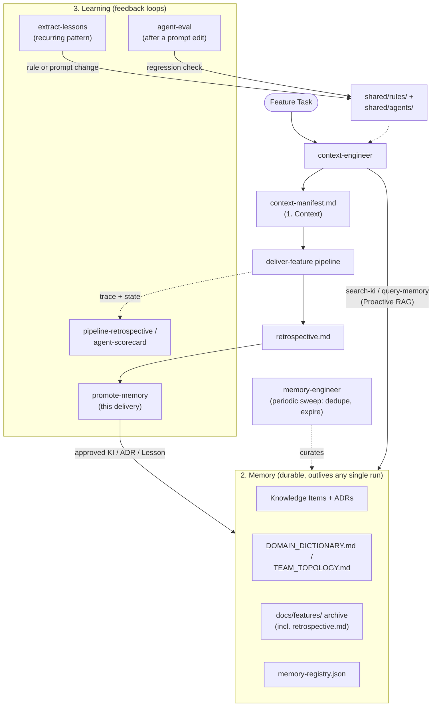

# Context, Memory & Learning Guide

This runbook covers three related but distinct concerns in this framework, and is the map for how they fit
together:
- **Context** — what's loaded into an agent's window for the current turn/run. Solves "is this agent
  looking at the right, minimal set of files right now."
- **Memory** — durable knowledge that outlives any single run. Solves "has this already been figured out
  somewhere, so we don't re-derive it."
- **Learning** — feedback loops that change future agent behavior based on past runs. Solves "will the next
  similar feature actually go better than this one did."

Conflating these three is the most common mistake: a well-pruned context window (this run went smoothly)
says nothing about whether the framework is *learning* from that run for next time, and a rich memory corpus
(KIs, ADRs) says nothing about whether any given agent's context window is actually well-scoped today.

`context-engineer` (`shared/agents/context-engineer.md`) is the agent responsible for Context; it also reads
Memory (Knowledge Items, ADRs, prior deliveries) to build a better manifest, but does not itself produce
Learning — that's a separate, mostly-periodic set of mechanisms covered in section 3 below.

Memory feeds Context (via `search-ki`/`query-memory`); a delivery produces Learning signals; approved
Learning writes back into Memory (new KIs) and into the agents/rules themselves (a prompt or rule edit) —
which is what actually makes the *next* Context-building pass better, closing the loop.

---

## 1. Context

### When to Use
- Before launching a new agent pipeline or feature task.
- When an agent becomes slow, starts repeating itself, or shows signs of context drift (forgetting
  guidelines or earlier instructions).
- To optimize token consumption and reduce execution latency.

### The Context Challenge
LLMs operate on a finite context window. Reasoning accuracy and instruction-following degrade as the window
fills with noise, even well before the hard token limit:
- **Context Drift**: as conversation history grows, earlier instructions, architecture rules, and specs
  lose influence over the model's responses.
- **Signal-to-Noise Ratio (SNR)**: unrelated files, redundant logs, and full directory listings reduce the
  density of relevant information, causing errors.

### Context Taxonomy
Context is categorized into six layers, ordered from permanent/static to ephemeral/dynamic. This taxonomy
describes what's loaded *right now* — it is not where things are durably stored (that's Memory, section 2).

| Layer | Name | Source | Lifetime |
|---|---|---|---|
| 1 | System Context | `CLAUDE.md`, `.cursorrules` and equivalents per platform | Session-long |
| 2 | Rule Context | `ARCHITECTURE_RULES.md`, `shared/rules/` | Session-long |
| 3 | Knowledge Context | `shared/knowledge/` + `.claude/knowledge/` KIs, `docs/adrs/` | Demand-driven |
| 4 | Task/Goal Context | Feature spec, `analysis.md` | Task-long |
| 5 | Historical Context | Thread history, `docs/features/` | Ephemeral |
| 6 | Runtime Context | Open files, tool outputs | Real-time |

### Core Principles

1. **Principle of Least Context (Least Privilege)** — agents load only what's necessary for the immediate
   sub-task. Don't read entire directories recursively when only an interface matters. Don't read a whole
   500+ line file when only a 50-line section matters — use line-range reads. Don't keep unrelated files
   open.
2. **Proactive RAG** — before independent analysis or design, check whether the problem is already solved.
   `context-engineer` invokes the `search-ki` skill, which searches `shared/knowledge/`, `.claude/knowledge/`,
   and `docs/adrs/` together (see section 2 — this is a Memory lookup performed as part of building Context).
3. **State Externalization** — don't force an agent to hold long checklists or detailed state in the active
   conversation. This framework's actual externalization mechanism is
   `.claude/feature-workspace/pipeline-state.json` (resumability, read by `resume-pipeline`) and
   `.claude/feature-workspace/pipeline-trace.json` (timing/iteration history, read by `pipeline-retrospective`
   and `agent-scorecard`) — see `shared/skills/deliver-feature/SKILL.md`, "Checkpointing & Pipeline State."
   Each pipeline artifact (`analysis.md`, `architecture-notes.md`, etc.) is itself an externalization of that
   agent's reasoning, handed off structurally rather than kept in conversation.
4. **Dynamic Context Loading (Just-in-Time)** — load files when needed, summarize once processed. An
   artifact 2+ pipeline phases old is read as a gist rather than in full — this is "Context Decay," see
   `shared/skills/deliver-feature/SKILL.md`. For a typed artifact under `loom run` that gist is a
   deterministic projection; for the artifacts that still pass as markdown it is a `summarize-artifact`
   summary.
5. **Isolation of Subagent Boundaries** — spawning a subagent is a clean slate: it sees only its own
   definition and the specific artifact/task handed to it, never the orchestrator's full history or another
   subagent's internal reasoning. The orchestrator only ever consumes a subagent's final structured report
   (see `shared/knowledge/subagent-isolation-is-a-hard-boundary.md`).
6. **Judgment Over Blanket Constraints** — newer models handle repo-local judgment better than long lists of
   defensive absolutes. Keep hard safety gates hard (`approval-gates.md`, destructive migrations, secrets,
   architecture boundaries), but phrase style and implementation guidance as "match the surrounding code" or
   "prefer the established pattern" instead of repeating brittle universal rules in every prompt.
7. **Interfaces Over Examples** — when a tool, skill, script, or artifact is confusing, improve its
   interface first: names, schemas, status enums, required sections, defaults, and validation errors carry
   more reusable signal than a pile of examples. Keep examples for high-risk protocols or genuinely
   non-obvious workflows.
8. **Progressive Disclosure Before Central Catalogs** — root prompts (`CLAUDE.md`, `AGENTS.md`, generated
   platform prompts) should identify the framework and routing map, not become encyclopedias. Detailed
   verification, review, migration, and domain guidance belongs in skills/runbooks that are loaded only when
   relevant.
9. **Rich References Beat Prose Summaries** — when a task depends on taste or fidelity, prefer references
   the model can inspect directly: interfaces, tests, fixtures, schemas, HTML mockups, rubrics, prior
   implementation files, or golden outputs. A prose spec is still useful, but it should point at the
   highest-fidelity reference available instead of paraphrasing it.

The Claude 5 context-engineering guidance published by Anthropic on 2026-07-24 is the external calibration
point for principles 6-9: their reported direction is smaller upfront prompts, heavier progressive
disclosure, simpler tool descriptions, and richer references. This framework keeps stronger hard gates than
Claude Code's default system prompt because it encodes organizational risk controls, but those gates should
not be used as an excuse to duplicate obvious guidance everywhere.

`context-engineer` is the agent responsible for keeping Layers 3-6 high-signal before the rest of the
pipeline starts. Its output, `context-manifest.md`, has a required structure enforced by
`shared/contracts/context-manifest-contract.md` via `validate-artifact` — the same structural gate every
other pipeline artifact gets.

---

## 2. Memory

Durable knowledge, each with its own storage location and retrieval mechanism. These don't compete with each
other — each answers a different question about the past.

| Mechanism | Answers | Stored In | Retrieved By | Distinct From |
|---|---|---|---|---|
| `shared/memory-registry.json` | "What memory sources exist, and what's each one's retrieval backend?" | `shared/memory-registry.json` | Read by `search-ki`, `query-memory`, and `memory-engineer` before they do anything else | Not itself searchable content — a catalog of where the other rows in this table live |
| Knowledge Items (KIs) | "Has this pattern/bug/decision already been solved?" | `shared/knowledge/` (portable), `.claude/knowledge/` (project-specific) | `search-ki` — tag/domain pre-filter, then LLM judgment read, no embeddings (see `search-ki`'s own guardrails for why); `query-memory` when the question isn't specifically KI/ADR-shaped | ADRs — a KI is a reusable pattern or fix, not a rationale for a specific past choice |
| ADRs | "Why did we choose X over Y?" | `docs/adrs/` | `search-ki` (same call, treated as first-class alongside KIs) | KIs |
| `DOMAIN_DICTIONARY.md` | "What's the correct term for this concept?" | `shared/DOMAIN_DICTIONARY.md` | Read directly by every agent at a fixed process step; also covered by `query-memory` | `TEAM_TOPOLOGY.md` — vocabulary, not org structure |
| `TEAM_TOPOLOGY.md` | "Who owns this bounded context, and how should a crossing into it work?" | `shared/TEAM_TOPOLOGY.md` | `architect` (Context Crossings) and `team-topology-check` | `DOMAIN_DICTIONARY.md` |
| `docs/features/` archive | "What actually happened when we built this before?" | `docs/features/<name>/` (all persisted pipeline artifacts, including `retrospective.md`) | Two complementary checks: `context-engineer` step 4 greps for prior deliveries in the *same bounded context*, recency-independent; `analyst` step 5 separately skims the 3 *most recent* deliveries for general process trends (see `docs/runbooks/scaling-cross-feature-learning.md` for how the bounded-context lookup scales); also covered by `query-memory` | `pipeline-state.json`/`pipeline-trace.json` — ephemeral, per-run only, not a durable narrative |
| `pipeline-state.json` / `pipeline-trace.json` | "Where did this specific run get to, and how long did each step take?" | `.claude/feature-workspace/` (ephemeral, one active run at a time) | `resume-pipeline` (state, for resuming/rolling back), `pipeline-retrospective` + `agent-scorecard` (trace, aggregated across many runs) | `docs/features/` — this is raw per-run data, not a written narrative |

Curating the KI corpus itself (finding duplicates, flagging stale entries for expiration, keeping the
registry accurate) is `memory-engineer`'s job — a periodic sweep, not a per-task retrieval concern. See
[memory-engineering.md](memory-engineering.md) for the full lifecycle (Capture→Candidate→Audit→Approve→
Index→Retrieve→Expire) and promotion/expiration criteria.

---

## 3. Learning

Feedback loops that change future agent behavior. These are mostly periodic or manually triggered, not
wired into every single `deliver-feature` run — running all of them on every delivery would be its own kind
of over-engineering for a mechanism most features don't need triggered that often.

| Mechanism | Answers | Cadence | Persists To | Distinct From |
|---|---|---|---|---|
| `retrospective` | "How did this one delivery go?" (qualitative narrative) | Auto-invoked every 5th delivery, or on request | `docs/features/<name>/retrospective.md` | `pipeline-retrospective` — single delivery, not cross-delivery trends |
| `pipeline-retrospective` | "Is an agent getting slower or more retried over time, across many deliveries?" | Manual, periodic | `docs/pipeline-retrospectives/` | `agent-scorecard` — timing/iteration, not quality |
| `agent-scorecard` | "Was an agent's *output* actually good this month, across real deliveries?" | Manual, monthly | `docs/agent-metrics/scorecard-<YYYY-MM>.md` | `agent-eval` — real deliveries, not a fixed fixture |
| `agent-eval` | "Did editing this agent's prompt just regress it on a known case?" | Run right after editing a `shared/agents/*.md` file | `docs/agent-metrics/evals/<agent>-eval-<date>.md` | `agent-scorecard` — one fixed fixture, not a trend across real deliveries |
| `extract-lessons` | "Is there a recurring finding across many deliveries worth promoting to a rule, prompt change, or new KI?" | Manual, periodic | `docs/lessons-learned/` (gated by `shared/rules/approval-gates.md`) | `retrospective` — cross-delivery pattern mining, not one delivery's story |
| `promote-memory` | "Is anything in *this one* retrospective worth promoting right now?" | Run immediately after each `retrospective.md` is produced | A Candidate Record for human review (see [memory-engineering.md](memory-engineering.md)'s Memory Contract) — not written directly to `shared/knowledge/` until approved | `extract-lessons` — one delivery, immediate, not a cross-delivery recurring-pattern threshold |

The through-line: `retrospective` and `docs/features/` (Memory) capture what happened; `pipeline-retrospective`
and `agent-scorecard` judge whether it's trending better or worse; `agent-eval` catches an immediate prompt
regression; `extract-lessons` is the mechanism that actually closes the loop — turning a recurring pattern
into a permanent change (a new rule, an edited prompt, or a new KI) rather than a one-time observation.

---

## Verification
To confirm context is well-managed on an active run:
- `context-manifest.md` passes `shared/contracts/context-manifest-contract.md` (checked automatically by
  `validate-artifact` in `deliver-feature`, step 7).
- The active open files only belong to the component currently being modified.
- Terminal/command output in context is concise (use filters, `head`, or limit counts like `git log -n 5`).
- No duplicate copies of the same file or guideline exist across the loaded context.
- No prompt, skill, or rule repeats guidance already obvious from the filesystem, schema, tool signature, or
  a more specific loaded runbook.
- Pinpoint references favor high-fidelity artifacts (interfaces, tests, schemas, rubrics, mockups) over
  prose paraphrases when both exist.
- Run `context-audit` after a delivery to check whether pinned files were actually referenced, and whether
  any large file was loaded without a line-range constraint.

---
*Part of the [ai-assistant-dot-files](https://github.com/orieken/loom) Context Engineering Framework by Oscar Rieken — licensed under [CC BY 4.0](https://github.com/orieken/loom/blob/main/LICENSE-CONTENT.md). If you copy or adapt this file, please keep this attribution.*

## Pinning by dependency, not by guess (ADR-010)

When a repository has been indexed (`loom index`) and the `loom` MCP server is registered, `context-engineer` asks the
repo graph what a change reaches (`mcp__loom__impact`) instead of guessing which files depend on it, and records the
question — only the paths and depth — in the manifest's `blastRadius`. `loom` computes the answer from the graph and
writes it over anything the agent put there, as it does the token budget. Without a graph the agent falls back to grep
and says so. See [repo-context-indexing.md](repo-context-indexing.md).
